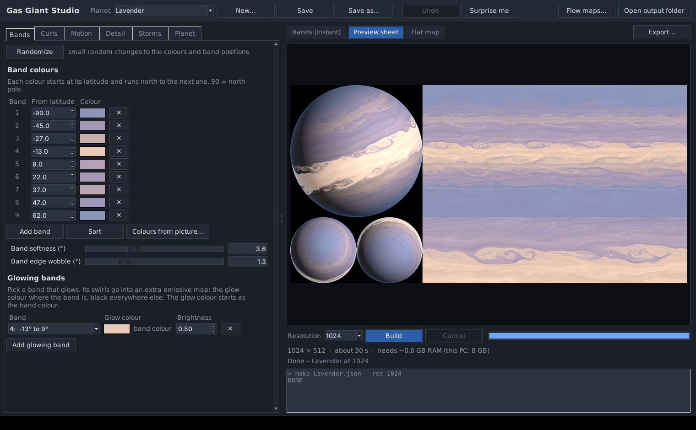
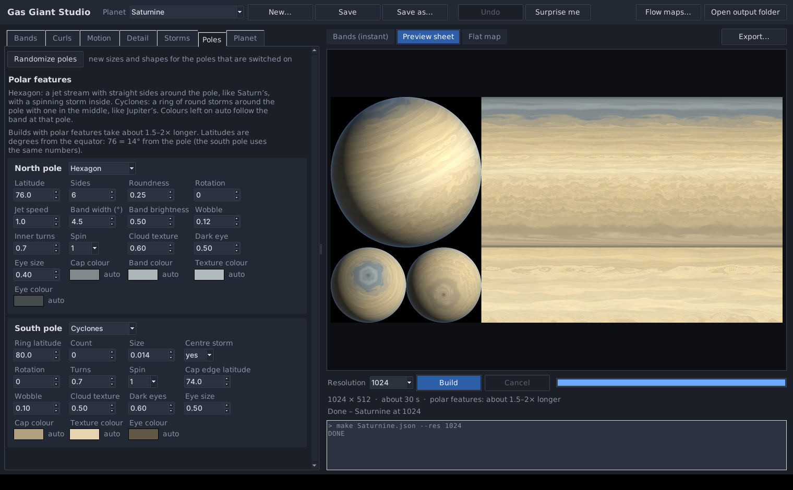
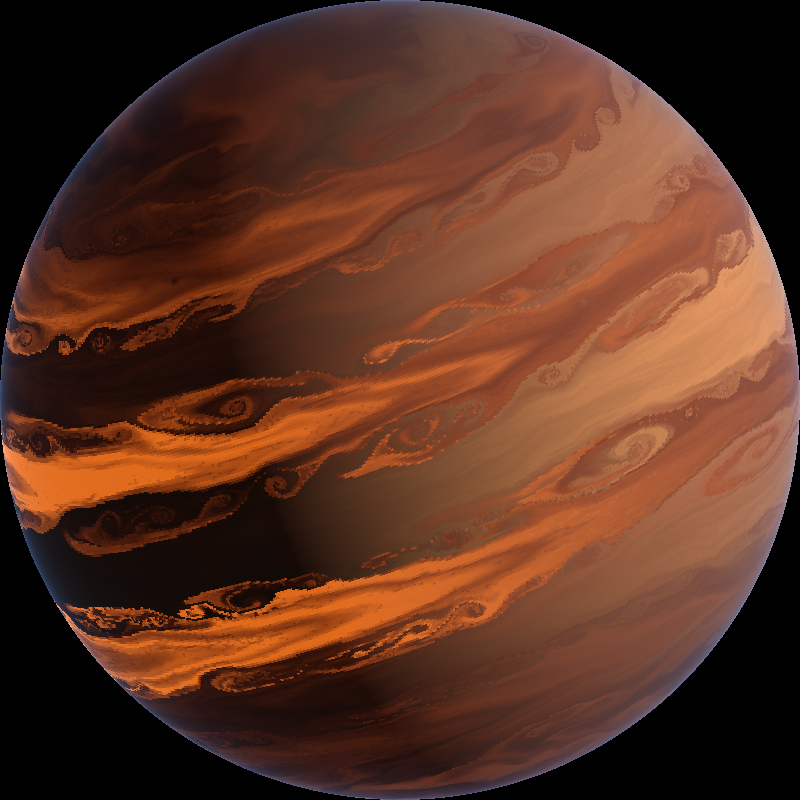
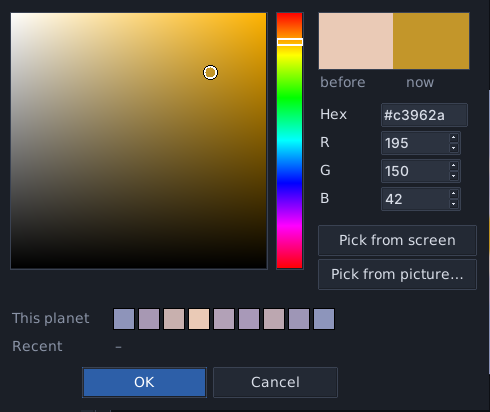
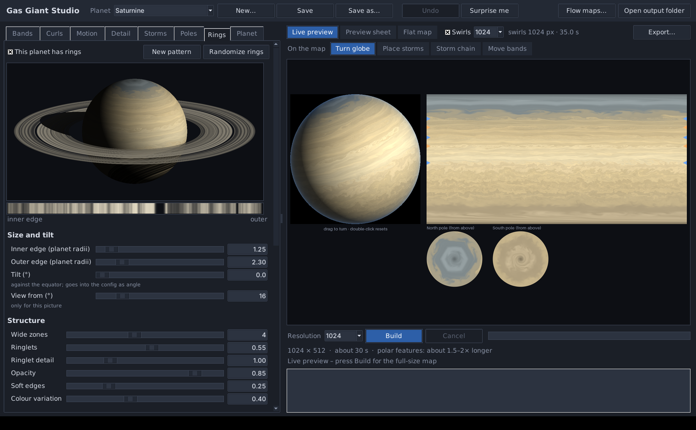
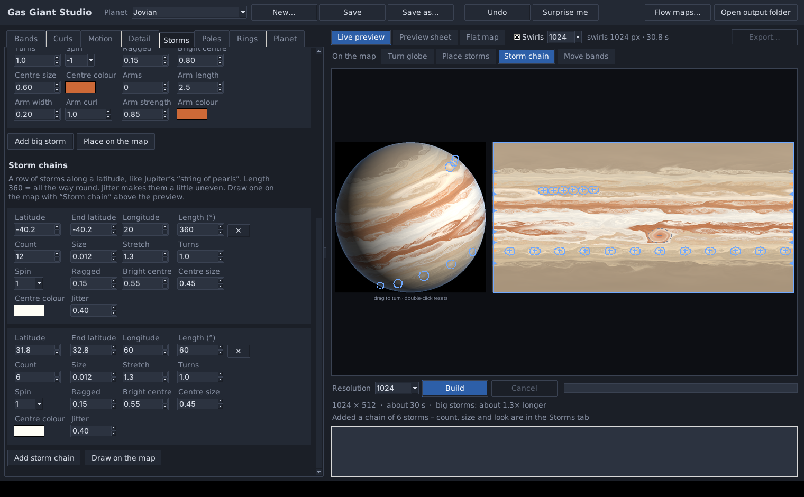
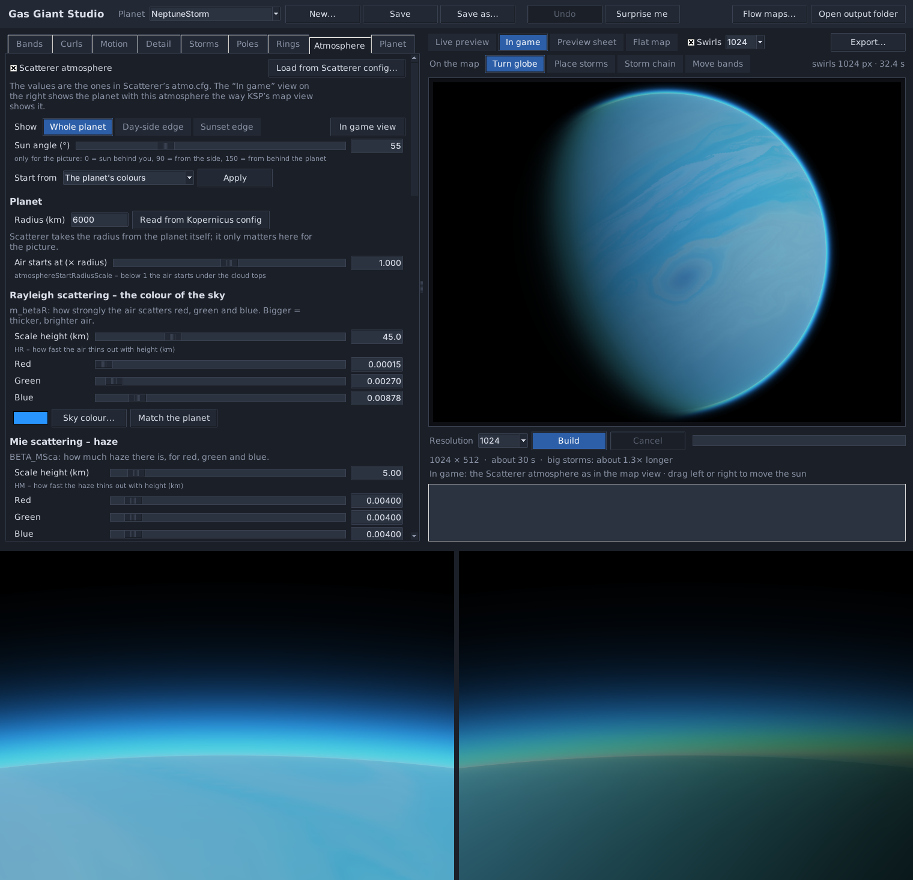
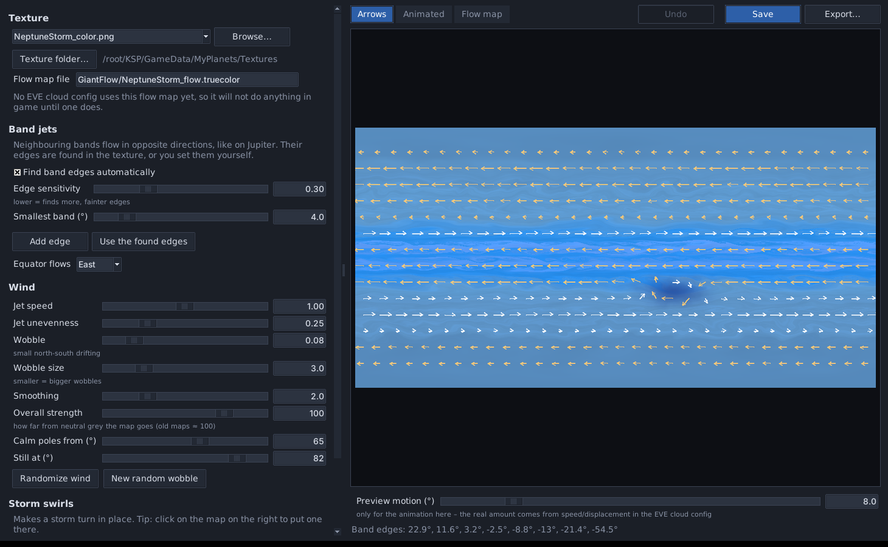

# Gas Giant Studio



Gas Giant Studio makes swirly, banded gas giant textures for Kerbal Space Program
planet mods (Kopernicus). It also makes the matching normal map, an EVE flow map, so the
cloud layer can drift along the bands, and if you like an emissive map for glowing bands.

The swirls are not painted on. Every pixel of the map is carried along a simulated
wind field, so the band edges roll up into soft Kelvin-Helmholtz curls with long, fine
filaments, the way they do on real gas giants.

## Download and start

**Windows:** download `GasGiantStudio-<version>-windows-x64.zip`, unzip it anywhere and
start `GasGiantStudio.exe`. You don't need to install Python.

**From source (any system):** install Python 3.9 or newer, then

```
pip install numpy pillow
python gasgiant_ui.py
```

On Windows you can also double-click `Run Gas Giant Studio.bat`. It installs numpy
and Pillow the first time.

Some antivirus programs are suspicious of new, unsigned apps made with PyInstaller. If
yours complains, you can run Gas Giant Studio from source instead; it's the same program.

## What it can do

- **Bands:** pick a colour for every band. Each colour starts at its latitude and runs
  north to the next one. **Colours from picture...** reads the band colours from a
  reference image: click the north end, then the south end of a line across the bands.
- **Colour picker:** click any colour box for a colour picker with a colour square, hex
  and RGB, the planet's other band colours and your recent colours. **Pick from screen**
  is an eyedropper for anything on your screen (a photo in your browser, the preview
  itself), **Pick from picture...** for an image file. The planet updates while you pick.
- **Band thickness:** make a band thicker or thinner along its length with a small curve
  editor. Pull it down to 0% and the band stops there, so the bands next to it meet, like the
  dark belt that ends at Jupiter's Great Red Spot. The curls along its edges follow.
- **Glowing bands:** pick a band that glows. Everything that band is made of, including
  the bits that get rolled into curls and storms, goes into an emissive map in a glow
  colour of your choice (the band colour unless you pick another one), black everywhere
  else.
- **Night-side glow:** a heat glow over the whole planet for hot Jupiters. The darker,
  deeper clouds glow more, and the glow follows every swirl. It goes into the emissive map
  as well.
- **Curls:** rows of swirls along the band edges. You set their size, how far they roll
  up, their spacing and their spin. **Auto-place** puts them where the band colour changes.
- **Motion and Detail:** jet streaks, turbulence, thin light threads, soft patches and
  calm poles.
- **Storms:** small storm spots scattered over the planet, and big storms that you place
  yourself. A big storm works like a small one, only bigger: a spiral that winds the bands
  up, with a bright (or dark) centre. Stretch it into an oval, make the edge ragged, and
  give it spiral cloud arms if you like. **Storm chains** put a row of storms along a
  latitude, like Jupiter's "string of pearls".
- **Edit on the map:** the tools above the preview let you work right on the planet.
  **Place storms**: click the map or the globe to add a big storm, drag to move it,
  right-click to remove it. **Storm chain**: drag along a latitude to draw a chain, or
  click once for a ring of storms all the way round. **Move bands**: drag a band edge up
  or down (the curls on that edge come along), double-click to split a band,
  right-click an edge to remove it.
- **Poles:** a hexagon jet stream around a pole like Saturn's, or a ring of cyclones like
  Jupiter's, separately for the north and south pole. You set the size, number of sides
  or storms, spin, texture, dark eyes and colours.
- **Rings:** a ring texture for Kopernicus rings with wide zones, fine ringlets, gaps and
  soft edges, coloured from the planet's bands or your own colours. The Rings tab shows
  the planet with its rings (with shadows) and gives you the Kopernicus config to paste.
- **Atmosphere:** a Scatterer atmosphere with Scatterer's own values (HR, m_betaR, HM,
  BETA_MSca, m_mieG, ozone, config points with their exposures and so on). The **In game**
  view shows the planet with that atmosphere the way KSP's map view does, as a whole planet
  or close up at the day-side or sunset edge. **Load from Scatterer config...** reads an
  existing atmo.cfg, and the tab gives you the atmo.cfg and the planet list entry to paste
  or save.
- **Randomize:** every tab has its own Randomize button. **Surprise me** randomizes
  everything at once, and **Undo** (or Ctrl+Z) goes back.
- **Live preview:** while you edit, the preview shows the real swirls by itself a moment
  later: a quick rough version first, then a sharper one (512 or 1024 pixels wide). Colour
  changes show in about half a second. Drag the globe to turn it. **Build** makes the
  full-size map and the game files.
- **Sizes:** 512, 1024, 2048, 4096, 8192 and 16384 pixels wide. The window shows about how
  long a build takes.
- **Export:** you choose the folder, the file names, the format and the size.

  | File | Formats |
  |---|---|
  | Colour map | DDS (BC1/DXT1 KSP-ready, BC3/DXT5, BC7), PNG, JPG, TGA, BMP |
  | Normal map | DDS (DXT5nm KSP-ready, BC5), PNG |
  | Flow map | `.truecolor` (EVE), PNG |
  | Emissive map | DDS (BC1/DXT1 KSP-ready, BC3/DXT5, BC7), PNG |
  | Ring texture | DDS (BC3/DXT5 with alpha, BC7), PNG |
  | Scatterer config | `.cfg` (atmo.cfg and the planet list entry) |
  | Preview sheet | PNG, JPG |

- **Flow Map Maker:** makes EVE flow maps for **any** gas giant texture, including ones
  you didn't make here. It finds the bands, lets neighbouring bands flow in opposite
  directions and adds storm swirls where you click. It shows the result as arrows or as
  a looping animation.















## Using the files in KSP

Which DDS format to pick:

| Map | Format | When |
|---|---|---|
| Colour, emissive | BC1 / DXT1 | the default; what KSP uses out of the box |
| Colour, emissive | BC7 | best quality, twice the file size |
| Colour, emissive | BC3 / DXT5 | when you need an alpha channel |
| Normal | DXT5nm | the default; for KSP's own planet shaders |
| Normal | BC5 | for shaders that ask for a BC5 normal map |

BC5 and BC7 need a texture loader that can read them, such as KSPTextureLoader.

DDS files are flipped upside down on export, because KSP expects that. Turn it off in
the export window if you need the files for something else.

A Kopernicus scaled-space body uses the colour and normal map like this:

```
ScaledVersion
{
	type = Atmospheric
	OnDemand
	{
		texture = MyPlanets/Textures/MyGiant_color.dds
		normals = MyPlanets/Textures/MyGiant_normal.dds
	}
}
```

To make the clouds move, give the planet an EVE cloud layer that uses the colour map as
its texture and the flow map as its `_FlowMap`:

```
EVE_CLOUDS
{
	OBJECT
	{
		name = MyGiant-clouds
		body = MyGiant
		altitude = 20000
		settings
		{
			_MainTex
			{
				value = MyPlanets/Textures/MyGiant_color
			}
			_FlowMap
			{
				speed = 0.06
				displacement = 0.2
				texture
				{
					value = MyPlanets/Textures/GiantFlow/MyGiant_flow
				}
			}
		}
	}
}
```

`speed` and `displacement` decide how fast and how far the clouds move in game. The
animation in the Flow Map Maker is only an approximation of that.

The emissive map is added on top of the planet's colours, so a mod that draws an
additive emissive layer on the scaled planet is needed, for example
`VertexColorMapEmissive` from DuckweedUtils:

```
ScaledVersion
{
	VertexColorMapEmissive
	{
		blendMode = Additive
		map = MyPlanets/Textures/MyGiant_emissive.dds
		brightness = 0.5
	}
}
```

The preview sheet shows the glow added to the planet, strongest on the night side. With
night-side glow on, the preview lights the planet from the side so the night side shows.

Rings go into the planet's Body node. The Rings tab shows this with your numbers and file
name filled in (Kopernicus measures the radii in thousandths of the planet radius):

```
Rings
{
	Ring
	{
		innerRadius = 1250
		outerRadius = 2300
		angle = 0
		texture = MyPlanets/Textures/MyGiant_ring
		color = 1,1,1,1
		lockRotation = false
		useNewShader = true
	}
}
```

The ring texture is a long thin strip. Its left end is the outer edge of the ring and its
right end the inner edge, because that is how Kopernicus maps it.

### Scatterer atmosphere

The Atmosphere tab writes a normal Scatterer config. The atmosphere goes into any .cfg
file in your mod, for example `GameData/MyPlanets/Scatterer/Planets/MyGiant/atmo.cfg`:

```
Scatterer_atmosphere
{
	Atmo
	{
		name = MyGiant
		atmosphereStartRadiusScale = 1
		HR = 45
		HM = 5
		m_betaR = 0.000152,0.0027,0.00878
		BETA_MSca = 0.004,0.004,0.004
		m_mieG = 0.8
		...
		configPoints
		{
			Item
			{
				altitude = 0
				skyExposure = 0.18
				...
			}
		}
	}
}
```

Scatterer only draws planets that are in its planet list, so the tab also gives you the
entry for that:

```
@Scatterer_planetsList:AFTER[Kopernicus]
{
	@scattererCelestialBodies
	{
		Item
		{
			celestialBodyName = MyGiant
			transformName = MyGiant
			mainSunCelestialBody = Sun
			...
		}
	}
}
```

The units are Scatterer's: HR, HM and the ozone height in km, the scattering values per km.
Scatterer works out the top of the atmosphere from them and takes the radius from the
planet itself, so the radius in the tab is only for the picture. The map view uses the
last config point (the highest altitude), and so does the In game view. Scatterer builds
its tables in game the first time it sees new values, which takes a few seconds.

The In game view is a close match, not a copy of the game: KSP's own lighting, EVE clouds,
godrays and the rim and shine values are not in it.

## Presets

Every planet is one small JSON file in `presets/`. Eight examples come with it:

| Preset | Look |
|---|---|
| Lavender | pastel lavender and peach bands with lots of curls and a glowing peach band |
| NeptuneBlue | pale blue with one deep blue band of wispy streaks |
| NeptuneStorm | the same with a big dark spiral storm and a Scatterer atmosphere |
| TealBands | teal and cream bands with a big pale storm with two arms |
| Jovian | Jupiter-like belts with a red storm and a dark belt that stops at the storm |
| JovianPoles | the same with Jupiter's rings of cyclones at both poles |
| Saturnine | pale gold Saturn-like bands with a hexagon in the north, one big vortex in the south and rings |
| Ember | a dark hot Jupiter whose deep belts glow red-orange on the night side |

Builds go to `out/<name>/` (4096) and `out/<name>_<size>/` (other sizes). Every build
also saves the settings it was made with.

## Command line

Everything the window does also works from the command line, which is handy for scripts.

```
python gasgiant.py make Lavender --res 1024
python gasgiant.py export Lavender --res 1024 --to export --color bc7 --normal dds --emissive png --ring none --atmo none
python gasgiant.py new MyGiant --template NeptuneBlue
python gasgiant.py flow MyGiant
python gasgiant.py sample picture.jpg X1 Y1 X2 Y2 --lat 70 -70
```

`--budget 150` stops a build after about 150 seconds and saves its progress. Running the
same command again continues where it stopped. With the Windows release, use
`GasGiantStudio.exe make ...` in the same way.

## Building the Windows release yourself

Install Python 3 for Windows, then double-click `build_release.bat` in this folder. It
makes a separate build environment with numpy, Pillow and PyInstaller, builds
`GasGiantStudio.exe`, test-runs it once and packs it into
`release/GasGiantStudio-<version>-windows-x64.zip` inside this folder.

## Requirements

- Windows release: 64-bit Windows 10 or 11.
- From source: Python 3.9+ with numpy, Pillow and Tkinter. Tkinter comes with the normal
  Python installers.
- RAM: about 1.5 GB for 4096, about 3 GB for 8192, about 6 GB for 16384.
